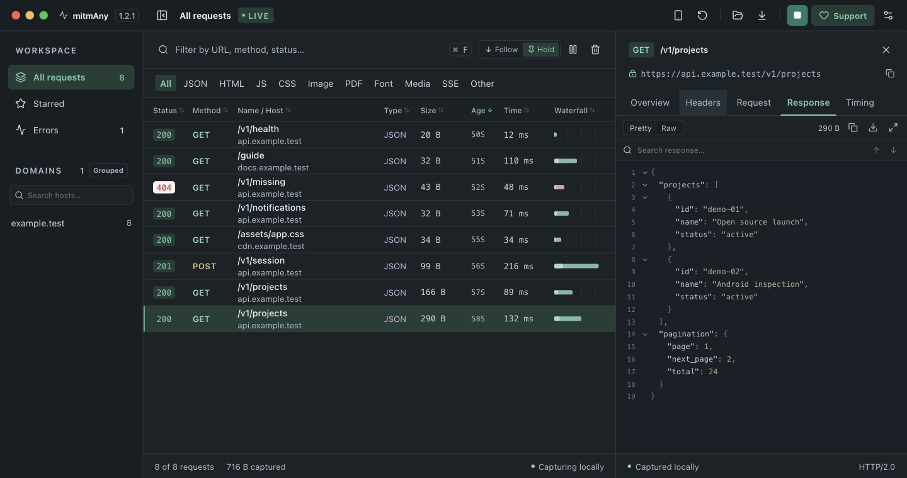

<h1 align="center">mitmAny</h1>

<p align="center"><a href="README.md">English</a> · <a href="README.zh-CN.md">简体中文</a> · <a href="README.zh-TW.md">繁體中文</a> · <a href="README.ja.md">日本語</a> · <a href="README.ko.md">한국어</a></p>

<p align="center">
  
</p>
<p align="center">
  
</p>

**AI に実際のネットワーク通信を見せよう。キャプチャしたリクエストから API を読み解く。**

mitmAny は、**AI によるリバースエンジニアリングを支援する HTTP / HTTPS トラフィック解析ツール**です。macOS、Windows、Android の USB キャプチャに対応。Codex などの MCP 対応クライアントを接続し、実際の通信を根拠に API、認証、ページネーション、レスポンス構造、業務フローを調べられます。

**ソフトウェアは 100% 無料・オープンソース。すべての機能を無料で利用できます。** 有料版、サブスクリプション、試用期限、有料の機能解除はありません。任意の支援は保守のためのもので、特典を解放しません。利用する AI クライアントやモデル提供元の料金は別途発生する場合があります。


## ダウンロード

**v1.2.1** · [Release](https://github.com/wonderfulsuccess/mitmAny/releases/tag/v1.2.1)

- [macOS — Apple Silicon / Intel ZIP](https://github.com/wonderfulsuccess/mitmAny/releases/download/v1.2.1/mitmAny-1.2.1-macos-universal.zip)
- [Windows — x64 ZIP](https://github.com/wonderfulsuccess/mitmAny/releases/download/v1.2.1/mitmAny-1.2.1-windows-amd64.zip)
- [SHA-256](https://github.com/wonderfulsuccess/mitmAny/releases/download/v1.2.1/SHA256SUMS.txt)

解凍してから起動してください。macOS はアプリを Applications に移動、Windows は WebView2 が必要です。このリリースは未署名で、macOS の公証もありません。[インストールと検証（英語）](docs/installation.md)。


## 通信を根拠に AI と API を解析


あなたがアプリを操作し、mitmAny が通信を記録し、AI がその意味を整理します。

| 調べたいこと | AI に依頼できる分析 |
| --- | --- |
| ドキュメントのない API | エンドポイント、メソッド、パラメーター、レスポンス構造をリクエスト ID 付きで整理。 |
| ログインとセッション | ヘッダー、Cookie、リクエスト順序を追い、観測結果と推測を区別。 |
| ページネーションと検索 | スクロールや条件変更による通信を比較し、カーソルやページ番号を特定。 |
| 業務フローや不具合 | 操作時刻を記録し、成功・失敗時の通信とタイミングを比較。 |
| 連携ドキュメント | 観測した通信から API メモやクライアントコードの草案を作成し、人が確認。 |

MCP がキャプチャセッションと AI をつなぎます。スクリーンショットや JSON を繰り返し貼り付ける代わりに、AI は状態確認、ホスト単位の観測、集計、検索、ヘッダーとサイズ制限付き本文の読み取り、新しい通信の待機を行えます。観測ブックマークはキャプチャを開始せず、削除された記録も保持しません。

**Settings → Codex** で同梱の `mitmany-network-analysis` skill と MCP 接続を設定し、MCP を再接続するか新しい Codex セッションを開きます。手動でキャプチャを開始して、例えば次のように依頼できます。

> `api.example.test` のログインとページネーションを分析してください。私がアプリを操作します。このホストだけを観測し、根拠となるリクエスト ID、欠落・切り詰められたデータ、未確認事項を明示して API 概要をまとめてください。

AI 分析は接続先のクライアントが行い、mitmAny 自体に大規模言語モデルは内蔵されていません。MCP は通信の読み取りと観測ブックマークの管理を行い、リクエスト再送、プロキシ変更、証明書ピンニングの回避は行いません。所有する、または解析を許可されたシステムに使用してください。[接続ガイド（簡体字中国語）](docs/manual.zh-CN.md#codex--mcp-网络协议分析)。


## 使い方と言語

1. **Settings → CA Certificate** でローカル CA をインストールし、信頼を設定します。未設定の HTTPS は復号されずトンネル転送されます。
2. デスクトップキャプチャを開始するか、USB デバッグを有効にした Android を接続し、Android パネルでプロキシを有効にします。
3. サイトやアプリを操作して通信を確認します。終了時はキャプチャを停止し、USB を抜く前に Android のプロキシを戻してください。

既定の UI は英語です。**Settings → Language** で **简体中文** に切り替えると設定が保存されます。README は 5 言語ですが、**ソフトウェアの UI は英語と簡体字中国語のみ**です。[ネットワーク復旧（英語）](docs/recovery.md)。

## 機能と制限

HTTP / HTTPS、HTTP/2、ストリーミングと SSE の先頭部分、ドメイン分類、検索、JSON 折りたたみ、HAR 入出力、cURL コピー、本文の保存、ライト／ダークテーマに対応。Android USB キャプチャに共通 Wi-Fi は不要です。

TUN、UDP、QUIC／HTTP3、証明書ピンニング回避、リクエスト再送、WebSocket の個別メッセージ表示には対応していません。クライアントはプロキシに従い CA を信頼する必要があり、Android アプリではデバッグ用の信頼設定が必要な場合があります。

リクエストと通常レスポンスはそれぞれ 1 MiB、HTML レスポンスは 8 MiB まで。展開時も同じ制限があります。保持上限は 3,000 リクエスト、本文合計 256 MiB。混雑時は転送を続けながら記録を省略・切り詰める場合があります。

通信と CA 秘密鍵はローカルに保存されます。**接続した AI クライアントはツールの結果をモデル提供元に送信する場合があります。** マスキングですべての秘密を除去できるとは限らず、エクスポートには認証情報が含まれ得ます。[プライバシー（英語）](docs/privacy.md) · [脆弱性の報告（英語）](SECURITY.md)。

## プロジェクトを支援

[US $1](https://buy.stripe.com/aFa7sMaQP5TIgZr7Xt97G02) · [US $10](https://buy.stripe.com/28E28s3oneqe6kNcdJ97G03) · [US $100](https://buy.stripe.com/fZu00k3on0zo8sV2D997G04)

支援は任意の一回払いです。自動更新、機能解除、優先サポートはありません。Stripe の加盟店名は **SimiSF** です。USD 価格は適用税を含み、現地通貨での見積もりが表示される場合があります。決済前に通貨と合計を確認してください。確認時は CNY 決済で Alipay と WeChat Pay が利用可能でしたが、USD では WeChat Pay は表示されませんでした。実際の決済画面が優先されます。バグ報告、文書改善、コードの貢献も歓迎します。

## 開発とライセンス

Go 1.26+、`.nvmrc` の Node.js、Wails CLI 2.15.0、各 OS のビルドツールが必要です。

```sh
nvm use
npm --prefix frontend ci
npm --prefix frontend test
npm --prefix frontend run build
go install github.com/wailsapp/wails/v2/cmd/wails@v2.15.0
wails dev
```

[Development](docs/development.md) · [Contributing](CONTRIBUTING.md) · [Changelog](CHANGELOG.md)

[MIT](LICENSE) · [Third-party licenses](THIRD_PARTY_NOTICES.md)

<details>
<summary>実際のアプリ画面を見る</summary>



*画面は合成データです。実際のアカウント情報は含みません。[デモ（英語）](docs/demo.md)*

</details>
