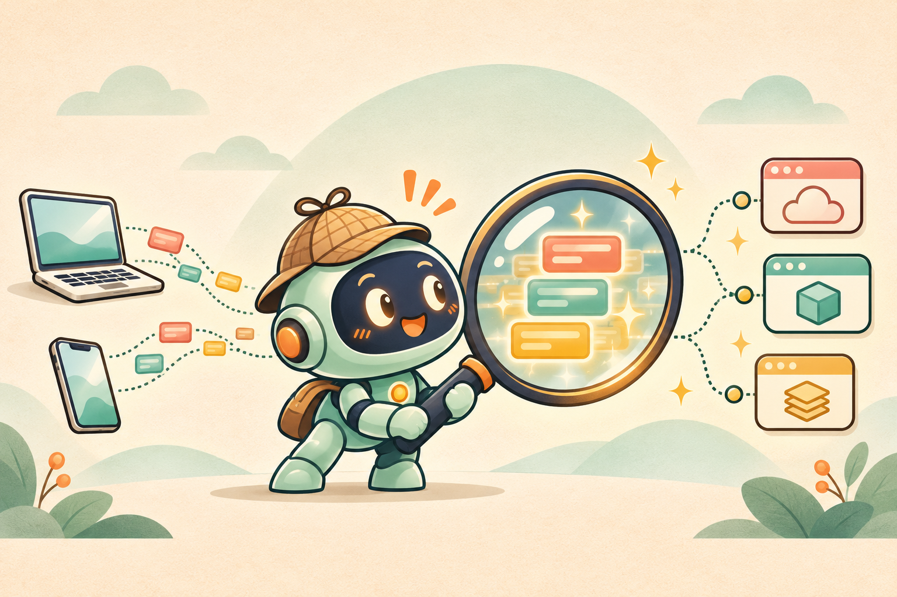
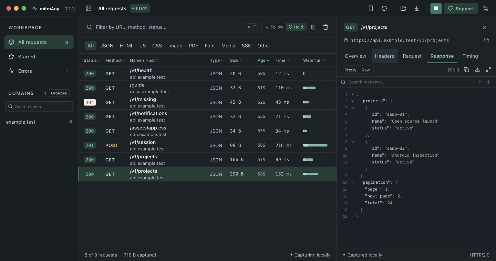

<h1 align="center">mitmAny</h1>

<p align="center"><a href="README.md">English</a> · <a href="README.zh-CN.md">简体中文</a> · <a href="README.zh-TW.md">繁體中文</a> · <a href="README.ja.md">日本語</a> · <a href="README.ko.md">한국어</a></p>

<p align="center">
  <strong>💚 mitmAny의 지속적인 개발을 응원해 주세요</strong><br />
  <a href="https://buy.stripe.com/aFa7sMaQP5TIgZr7Xt97G02"><strong>US $1</strong></a> &nbsp; · &nbsp; <a href="https://buy.stripe.com/28E28s3oneqe6kNcdJ97G03"><strong>US $10</strong></a> &nbsp; · &nbsp; <a href="https://buy.stripe.com/fZu00k3on0zo8sV2D997G04"><strong>US $100</strong></a><br />
  <sub>자발적인 일회성 후원 · 모든 기능은 무료</sub>
</p>

<p align="center">
  
</p>
<p align="center">
  
</p>

**AI가 실제 네트워크 요청을 보게 하세요. 캡처한 트래픽에서 API를 이해하세요.**

mitmAny는 **AI 기반 리버스 엔지니어링을 돕는 HTTP / HTTPS 트래픽 분석 도구**입니다. macOS, Windows와 Android USB 캡처를 지원합니다. Codex 등 MCP 호환 클라이언트를 연결하면 실제 요청을 근거로 API, 인증 흐름, 페이지네이션, 응답 구조와 비즈니스 프로토콜을 분석할 수 있습니다.

**소프트웨어는 100% 무료이며 오픈 소스입니다. 모든 기능을 무료로 제공합니다.** 유료 버전, 구독, 체험 기간, 유료 기능 잠금 해제가 없습니다. 자발적인 후원은 유지보수를 위한 것이며 추가 혜택을 제공하지 않습니다. 선택한 AI 클라이언트나 모델 제공업체는 별도 요금을 부과할 수 있습니다.


## 다운로드

**v1.2.1** · [Release](https://github.com/wonderfulsuccess/mitmAny/releases/tag/v1.2.1)

- [macOS — Apple Silicon / Intel ZIP](https://github.com/wonderfulsuccess/mitmAny/releases/download/v1.2.1/mitmAny-1.2.1-macos-universal.zip)
- [Windows — x64 ZIP](https://github.com/wonderfulsuccess/mitmAny/releases/download/v1.2.1/mitmAny-1.2.1-windows-amd64.zip)
- [SHA-256](https://github.com/wonderfulsuccess/mitmAny/releases/download/v1.2.1/SHA256SUMS.txt)

압축을 푼 후 실행하세요. macOS 앱은 Applications로 이동하고, Windows에는 WebView2가 필요합니다. 이 버전은 서명되지 않았으며 macOS 공증도 받지 않았습니다. [설치 및 검증(영문)](docs/installation.md).


## 앱 화면



*실제 계정 정보가 없는 합성 데이터입니다. [데모 안내(영문)](docs/demo.md)*

## 실제 트래픽을 근거로 AI와 API 분석하기


사용자가 앱을 조작하면 mitmAny가 증거를 기록하고 AI가 의미를 정리합니다.

| 알아보고 싶은 내용 | AI에 요청할 수 있는 분석 |
| --- | --- |
| 문서가 없는 API | 요청 ID를 인용하며 엔드포인트, 메서드, 매개변수와 응답 구조 정리 |
| 로그인과 세션 | 헤더, 쿠키, 요청 순서를 추적하고 관찰 사실과 추정 구분 |
| 페이지네이션과 검색 | 스크롤, 필터, 검색 요청을 비교하여 커서와 페이지 매개변수 확인 |
| 업무 흐름과 오류 | 조작 시점을 표시하고 성공·실패 요청, 응답, 소요 시간 비교 |
| 연동 문서 | 캡처를 바탕으로 API 설명과 클라이언트 코드 초안을 작성하여 검토 |

MCP는 캡처 세션과 AI 도구를 연결합니다. 스크린샷과 JSON을 반복해서 붙여 넣는 대신 AI가 캡처 상태 확인, 호스트별 관찰, 요약과 검색, 헤더 및 크기가 제한된 본문 읽기, 새 트래픽 대기를 수행할 수 있습니다. 관찰 북마크는 캡처를 시작하거나 삭제된 기록을 보존하지 않습니다.

**Settings → Codex**에서 내장된 `mitmany-network-analysis` skill과 MCP 연결을 설정한 뒤 MCP를 다시 연결하거나 새 Codex 세션을 여세요. 직접 캡처를 시작한 후 다음과 같이 요청할 수 있습니다.

> `api.example.test`의 로그인과 페이지네이션을 분석해 주세요. 제가 앱을 조작하겠습니다. 이 호스트만 관찰하고, 결론에 요청 ID를 인용하며 누락되거나 잘린 증거를 밝혀 주세요. API 개요와 확인이 필요한 사항을 정리해 주세요.

AI 분석은 연결된 클라이언트가 수행하며 mitmAny 자체에는 대규모 언어 모델이 내장되어 있지 않습니다. MCP는 캡처 읽기와 관찰 북마크 관리만 하며 요청 재전송, 프록시 변경, 인증서 고정 우회를 수행하지 않습니다. 소유하거나 분석 권한을 받은 시스템에 사용하세요. [연결 안내(중국어 간체)](docs/manual.zh-CN.md#codex--mcp-网络协议分析).


## 시작하기와 언어

1. **Settings → CA Certificate**에서 로컬 CA를 설치하고 신뢰하도록 설정하세요. 신뢰하지 않은 HTTPS는 복호화 없이 터널로 전달됩니다.
2. 데스크톱 캡처를 시작하거나 USB 디버깅을 켠 Android를 연결한 뒤 Android 패널에서 프록시를 활성화하세요.
3. 사이트나 앱을 조작하고 요청을 확인하세요. 종료 시 캡처를 중지하고 USB를 분리하기 전에 Android 프록시를 복원하세요.

기본 UI는 영어입니다. **Settings → Language**에서 **简体中文**를 선택하면 설정이 저장됩니다. README는 5개 언어로 제공하지만 **소프트웨어 UI는 영어와 중국어 간체만 지원합니다.** [네트워크 복구(영문)](docs/recovery.md).

## 기능과 제한

HTTP / HTTPS, HTTP/2, 스트리밍과 SSE 앞부분, 도메인 그룹, 검색, JSON 접기, HAR 가져오기·내보내기, cURL 복사, 본문 저장, 밝은·어두운 테마를 지원합니다. Android USB 캡처는 같은 Wi-Fi가 필요하지 않습니다.

TUN, UDP, QUIC／HTTP3, 인증서 고정 우회, 요청 재전송, WebSocket 개별 메시지 뷰어는 지원하지 않습니다. 클라이언트가 프록시를 사용하고 CA를 신뢰해야 하며 Android 앱에는 별도 디버그 신뢰 설정이 필요할 수 있습니다.

요청과 일반 응답은 각각 1 MiB, HTML 응답은 8 MiB까지 캡처하며 압축 해제에도 같은 제한이 적용됩니다. 보관 한도는 요청 3,000개와 본문 총 256 MiB입니다. 혼잡할 때 전달은 계속하면서 캡처 사본을 생략하거나 자를 수 있습니다.

트래픽과 CA 개인 키는 로컬에 저장됩니다. **연결된 AI 클라이언트는 도구 결과를 모델 제공업체에 전송할 수 있습니다.** 마스킹이 모든 비밀 정보를 제거하지는 않으며 내보낸 데이터에는 인증 정보가 포함될 수 있습니다. [개인정보 안내(영문)](docs/privacy.md) · [보안 제보(영문)](SECURITY.md).

## 프로젝트 후원

[US $1](https://buy.stripe.com/aFa7sMaQP5TIgZr7Xt97G02) · [US $10](https://buy.stripe.com/28E28s3oneqe6kNcdJ97G03) · [US $100](https://buy.stripe.com/fZu00k3on0zo8sV2D997G04)

후원은 자발적인 일회성 결제입니다. 자동 갱신, 기능 잠금 해제, 우선 지원은 없습니다. Stripe 가맹점 이름은 **SimiSF**입니다. USD 가격은 적용 세금을 포함하며 현지 통화 견적이 제공될 수 있으므로 결제 전 통화와 총액을 확인하세요. 확인 당시 CNY 결제에는 Alipay와 WeChat Pay가 표시되었지만 USD에는 WeChat Pay가 표시되지 않았습니다. 실제 결제 화면을 기준으로 하세요. 버그 제보, 문서 개선, 코드 기여도 환영합니다.

## 개발 및 라이선스

Go 1.26+, `.nvmrc`의 Node.js, Wails CLI 2.15.0과 플랫폼 빌드 도구가 필요합니다.

```sh
nvm use
npm --prefix frontend ci
npm --prefix frontend test
npm --prefix frontend run build
go install github.com/wailsapp/wails/v2/cmd/wails@v2.15.0
wails dev
```

[Development](docs/development.md) · [Contributing](CONTRIBUTING.md) · [Changelog](CHANGELOG.md)

[MIT](LICENSE) · [Third-party licenses](THIRD_PARTY_NOTICES.md)
