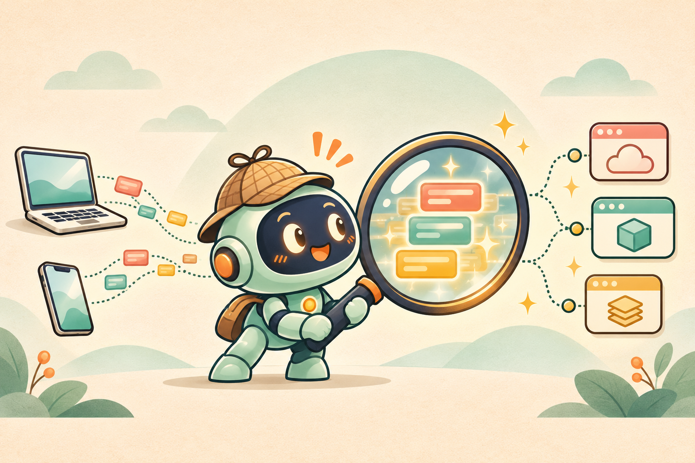
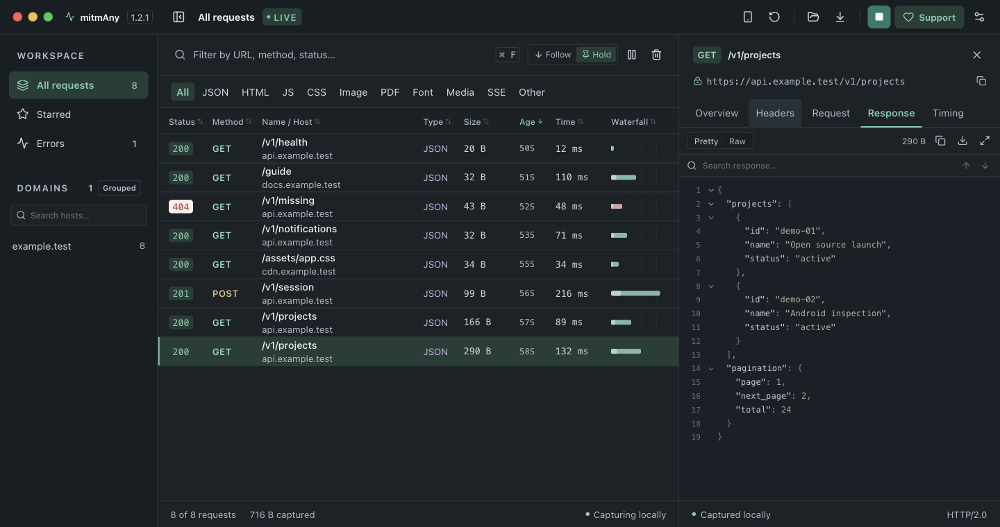
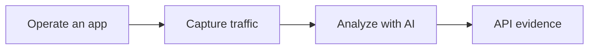

<h1 align="center">mitmAny</h1>

<p align="center"><a href="README.md">English</a> · <a href="README.zh-CN.md">简体中文</a> · <a href="README.zh-TW.md">繁體中文</a> · <a href="README.ja.md">日本語</a> · <a href="README.ko.md">한국어</a></p>

<p align="center">
  <strong>💚 Help keep mitmAny growing</strong><br />
  <a href="https://buy.stripe.com/aFa7sMaQP5TIgZr7Xt97G02"><strong>US $1</strong></a> &nbsp; · &nbsp; <a href="https://buy.stripe.com/28E28s3oneqe6kNcdJ97G03"><strong>US $10</strong></a> &nbsp; · &nbsp; <a href="https://buy.stripe.com/fZu00k3on0zo8sV2D997G04"><strong>US $100</strong></a><br />
  <sub>Optional one-time support · Every feature stays free</sub>
</p>

<p align="center">
  
</p>
<p align="center">
  
</p>

**Give your AI eyes on real network traffic. Turn captured requests into an API investigation.**

mitmAny is an **AI-ready HTTP / HTTPS traffic inspector** for macOS, Windows and Android USB workflows. Capture what a website or app actually sends, connect Codex or another compatible MCP client, and ask AI to help reverse-engineer APIs from real evidence: endpoints, authentication, pagination, response schemas and business flows.

**100% free and open source. Every mitmAny feature is free: no paid edition, subscription, trial expiry or feature paywall.** Optional tips fund maintenance and unlock nothing. Any fees charged by your chosen AI client or model provider are separate from mitmAny.

## Inside mitmAny



*This screenshot uses synthetic data. See the [demo walkthrough](docs/demo.md).*

## From captured traffic to AI-assisted reverse engineering




You operate the app. mitmAny captures the evidence. Your AI client helps make sense of it.

| What you want to understand | What you can ask AI to investigate |
| --- | --- |
| An undocumented API | Group observed endpoints, methods and parameters into an API outline, citing request IDs. |
| Login and session behavior | Trace observed headers, cookies and request order; distinguish evidence from assumptions. |
| Pagination and search | Compare requests while you scroll, change filters or search; identify cursor and page parameters. |
| A business workflow | Mark actions and inspect the corresponding time windows to map a sequence of requests. |
| A bug or unexpected response | Compare successful and failed requests, status codes, timing and captured bodies. |
| Integration documentation | Draft schema notes and client-code examples from captured evidence for you to review. |

MCP is the bridge between your capture session and your AI tools. Instead of repeatedly pasting screenshots and JSON, the AI client can inspect capture status, scope an observation to a host, summarize/search flows, read headers and bounded bodies, and wait for new traffic. Observation bookmarks help organize an investigation; they do not start capture or preserve evicted records.

The bundled `mitmany-network-analysis` skill guides evidence-based analysis. **Settings → Codex** installs the skill and registers the MCP connection locally. Reconnect MCP or open a new Codex session, then start capture yourself and try:

> Analyze the login and pagination protocol of `api.example.test`. I will use the app. Scope the observation to this host, cite request IDs for your conclusions, and call out missing or truncated evidence. Finish with an API outline and a list of uncertainties.

AI analysis runs in your connected client, not in an embedded model inside mitmAny. MCP reads captured traffic and manages observation bookmarks; it does not replay requests, change proxies or bypass certificate pinning. Use it for systems you own or are authorized to inspect. [Connection details (Chinese)](docs/manual.zh-CN.md#codex--mcp-网络协议分析).


## Language

English is the default language. Switch to **简体中文** in **Settings → Language**; your choice is saved for future launches. README translations are available in English, Simplified Chinese, Traditional Chinese, Japanese and Korean. The application interface supports English and Simplified Chinese only.

## Get started

1. Download a package from [Releases](https://github.com/wonderfulsuccess/mitmAny/releases). Move the macOS app to Applications; Windows requires WebView2.
2. Open **Settings → CA Certificate**, then install and trust your local CA to inspect HTTPS. Without trust, HTTPS is tunneled without decryption.
3. Start desktop capture, or connect an Android device with USB debugging enabled and turn on its proxy in the Android panel. Use your browser or app, then select a request.

Stop capture when finished. Restore the Android proxy before unplugging USB. Use the toolbar recovery button if desktop networking needs restoration. See [recovery and removal](docs/recovery.md) if the app cannot start.

## Features

- HTTP / HTTPS, HTTP/2, streaming responses and SSE prefixes.
- Domain grouping, filters, search, favorites, virtual lists, JSON folding and body search.
- Android USB capture without shared Wi-Fi.
- HAR import/export, copy as cURL, captured-body export.
- Local CA management, proxy backup/recovery, light and dark themes.
- Read-only MCP tools and a bundled protocol-analysis skill; connect through Settings → Codex.

## Limits and privacy

No TUN, UDP, QUIC or HTTP3 interception, certificate-pinning bypass, request replay or WebSocket message inspector. Clients must honor the proxy and trust the CA; Android apps may need explicit debug trust configuration.

Request and ordinary response capture: 1 MiB each. HTML response capture: 8 MiB. Decompression has the same limits. Retention: 3,000 requests and 256 MiB of body files. Busy queues may skip or truncate captures while forwarding continues. Observations do not pin evidence.

Traffic and CA keys stay local to mitmAny. **Connected AI clients may send tool results to their model provider.** Redaction covers common sensitive fields, not all possible secrets. HAR, cURL and body exports may contain credentials. Inspect only traffic you are authorized to access.

[Privacy](docs/privacy.md) · [Security reporting](SECURITY.md) · [Detailed Chinese manual](docs/manual.zh-CN.md)

## Development

Go 1.26+, Node.js from `.nvmrc`, Wails CLI 2.15.0 and native platform build tools are required.

```sh
nvm use
npm --prefix frontend ci
npm --prefix frontend test
npm --prefix frontend run build
go install github.com/wailsapp/wails/v2/cmd/wails@v2.15.0
wails dev
```

[Development](docs/development.md) · [Architecture](docs/architecture.md) · [Roadmap](docs/roadmap.md) · [Changelog](CHANGELOG.md) · [Releases](docs/releasing.md)

## Support the project

If mitmAny is useful to you, you can leave an optional, one-time tip to support ongoing maintenance:

[US $1](https://buy.stripe.com/aFa7sMaQP5TIgZr7Xt97G02) · [US $10](https://buy.stripe.com/28E28s3oneqe6kNcdJ97G03) · [US $100](https://buy.stripe.com/fZu00k3on0zo8sV2D997G04)

These are one-time payments, not subscriptions. Support does not unlock paid features or priority support. The Stripe checkout merchant is **SimiSF**.

Prices are set in USD and include applicable taxes. Stripe may offer a local-currency amount; review the currency and total before paying. Available payment methods depend on your region and checkout currency. Alipay and WeChat Pay were available in the CNY checkout when verified; WeChat Pay was not available in USD. The options shown at checkout take precedence.

Bug reports, documentation improvements and code contributions are also welcome.

## License

[MIT](LICENSE). Vendored dependencies retain their own licenses. See [third-party notices](THIRD_PARTY_NOTICES.md).
