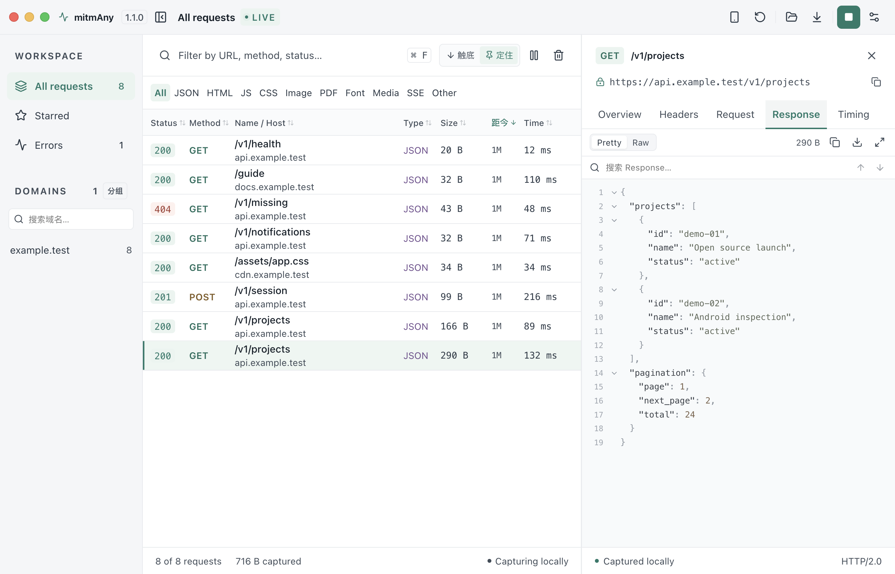

# mitmAny

**看清桌面与 Android 应用的 HTTP / HTTPS 请求，把真实流量交给 AI 辅助分析。**

mitmAny 是基于 Go、Wails 和 React 的开源桌面流量分析工具，支持 macOS 与 Windows。通过系统代理或 Android ADB USB 隧道采集流量，在本机查看请求、响应与时间线，也可通过只读 MCP 接口连接 Codex 等兼容客户端。

[English](README.md) · [下载安装](https://github.com/wonderfulsuccess/mitmAny/releases) · [使用详解](docs/manual.zh-CN.md) · [恢复与卸载](docs/recovery.md) · [参与贡献](CONTRIBUTING.md)



*截图使用合成流量，不包含真实账户或设备信息。[演示流程](docs/demo.md)*

## 下载安装

**v1.2.0** · [发布说明](https://github.com/wonderfulsuccess/mitmAny/releases/tag/v1.2.0)

| 系统 | 直接下载 |
| --- | --- |
| macOS — Apple Silicon / Intel 通用版 | [下载 macOS ZIP](https://github.com/wonderfulsuccess/mitmAny/releases/download/v1.2.0/mitmAny-1.2.0-macos-universal.zip) |
| Windows — x64 | [下载 Windows ZIP](https://github.com/wonderfulsuccess/mitmAny/releases/download/v1.2.0/mitmAny-1.2.0-windows-amd64.zip) |

[SHA-256 校验文件](https://github.com/wonderfulsuccess/mitmAny/releases/download/v1.2.0/SHA256SUMS.txt)。请先解压；macOS 应用移至 Applications，Windows 需要 WebView2。本次安装包未签名，macOS 未公证，可能出现系统安全提示。[安装与校验说明](docs/installation.md)

## 界面语言

软件首次启动默认使用英文。在 **Settings → Language** 中选择 **简体中文** 即可切换，语言偏好会保留到下次启动。

## 三步开始

1. **配置 HTTPS**：打开“管理证书”，安装并信任本机生成的 CA。未信任时 HTTPS 仅透传。
2. **选择来源**：点击播放按钮抓取电脑系统代理流量；或连接已开启 USB 调试的 Android，在 Android 面板开启手机代理。
3. **发起请求**：操作网页或应用，选择请求查看 Headers、JSON / 文本、图片与 Timing。结束后停止抓包；断开手机前关闭手机代理。

遇到断网可使用工具栏“恢复电脑网络”；手机在 Android 面板恢复。应用无法启动时参阅[恢复指南](docs/recovery.md)。仅分析自己有权访问和调试的流量。

## 能做什么

- HTTP / HTTPS、HTTP/2、流式响应与 SSE 正文前缀。
- 域名分组、筛选、搜索、收藏、虚拟列表、JSON 折叠与正文搜索。
- Android USB 抓包，无需手机与电脑在同一 Wi-Fi。
- HAR 导入 / 导出、复制 cURL、保存捕获正文。
- 系统代理备份与恢复、本机 CA 管理、深浅主题。
- 只读 MCP 查询与随包附带的协议分析 skill；在 Settings → Codex 中连接。

**AI 分析示例**：先开启抓包，再让 AI“分析 `api.example.test` 的登录和分页协议，我会操作 App；请引用实际请求作为证据”。[连接说明与工具边界](docs/manual.zh-CN.md#codex--mcp-网络协议分析)

## 能力边界

- 不覆盖忽略系统代理的应用、UDP / QUIC / HTTP3；没有 TUN 模式。
- 不绕过证书固定；Android 7+ 应用通常需要自行配置信任用户 CA。
- WebSocket 透传并记录握手，暂不提供逐条消息面板或请求重放。
- 请求与普通响应每方向最多 1 MiB，HTML 响应最多 8 MiB；解压同样受限。最多 3,000 条请求、256 MiB 正文预算。
- 队列繁忙时可能截断或跳过副本，继续转发。记录会淘汰，观察书签不固定证据。

## 隐私与安全

流量和 CA 私钥保存在本机；mitmAny 不主动上传抓包数据。**连接 AI 客户端后，工具返回的流量可能由客户端发送到模型服务。** 常见字段脱敏不能保证任意正文无敏感信息。HAR、cURL 和导出的正文可能包含凭证，分享前请检查。

[隐私与数据生命周期](docs/privacy.md) · [私下报告安全问题](SECURITY.md)

## 开发与贡献

依赖 Go 1.26+、Node.js（见 `.nvmrc`）、Wails CLI 2.15.0 和平台编译环境。

```sh
nvm use
npm --prefix frontend ci
npm --prefix frontend test
npm --prefix frontend run build
go install github.com/wailsapp/wails/v2/cmd/wails@v2.15.0
wails dev
```

[开发与测试](docs/development.md) · [架构](docs/architecture.md) · [路线图](docs/roadmap.md) · [更新记录](CHANGELOG.md) · [发布流程](docs/releasing.md)

## 支持项目

如果 mitmAny 对你有帮助，可以通过一次性、自愿的小费支持项目持续维护：

[US $1](https://buy.stripe.com/aFa7sMaQP5TIgZr7Xt97G02) · [US $10](https://buy.stripe.com/28E28s3oneqe6kNcdJ97G03) · [US $100](https://buy.stripe.com/fZu00k3on0zo8sV2D997G04)

以上均为一次性支付，不会自动续费，也不提供额外付费功能或优先支持。Stripe 支付页的收款商户名称为 **SimiSF**。

价格以美元设置，包含适用税费。Stripe 可能提供本地币种报价，请在付款前核对币种和总额。可用支付方式取决于地区和结账币种；验证时人民币结账提供支付宝和微信支付，美元结账未提供微信支付，最终以支付页显示为准。

提交问题、完善文档和贡献代码，同样是对项目的支持。

## 许可

[MIT](LICENSE)。本地维护的 `go-mitmproxy` 分支保留其原许可证与补丁说明。[第三方声明](THIRD_PARTY_NOTICES.md)
