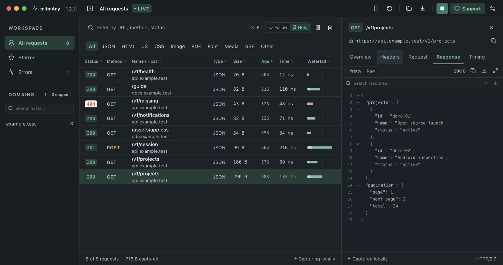

<h1 align="center">mitmAny</h1>

<p align="center"><a href="README.md">English</a> · <a href="README.zh-CN.md">简体中文</a> · <a href="README.zh-TW.md">繁體中文</a> · <a href="README.ja.md">日本語</a> · <a href="README.ko.md">한국어</a></p>

<p align="center">
  
</p>
<p align="center">
  
</p>

**讓 AI 看見真實網路請求，讓封包擷取成為 API 逆向分析的起點。**

mitmAny 是一款**為 AI 輔助逆向分析打造的 HTTP / HTTPS 流量檢視工具**，支援 macOS、Windows 與 Android USB 擷取。將網站或 App 的真實請求交給 Codex 等相容 MCP 的 AI 用戶端，協助釐清 API、驗證流程、分頁規則、回應結構與業務協定。

**軟體 100% 免費、開源，所有功能完全開放。沒有付費版、訂閱、試用期限或付費解鎖。** 自願贊助僅用於維護，不提供額外特權。你選用的 AI 用戶端或模型服務可能另行收費，與 mitmAny 的軟體費用無關。


## 下載

**v1.2.1** · [Release](https://github.com/wonderfulsuccess/mitmAny/releases/tag/v1.2.1)

- [macOS — Apple Silicon / Intel ZIP](https://github.com/wonderfulsuccess/mitmAny/releases/download/v1.2.1/mitmAny-1.2.1-macos-universal.zip)
- [Windows — x64 ZIP](https://github.com/wonderfulsuccess/mitmAny/releases/download/v1.2.1/mitmAny-1.2.1-windows-amd64.zip)
- [SHA-256](https://github.com/wonderfulsuccess/mitmAny/releases/download/v1.2.1/SHA256SUMS.txt)

請先解壓縮，macOS 應用程式移至 Applications；Windows 需要 WebView2。本版未簽署，macOS 未經公證。[安裝與驗證（英文）](docs/installation.md)。


## 從流量到 AI 輔助逆向分析


你操作網站或 App，mitmAny 記錄證據，AI 協助理解介面背後的邏輯。

| 想了解什麼 | AI 可以協助的分析 |
| --- | --- |
| 未提供文件的 API | 整理端點、方法、參數與回應結構，引用請求 ID。 |
| 登入與工作階段 | 追蹤 Header、Cookie 與請求順序，區分觀察與推測。 |
| 分頁與搜尋 | 比較捲動、搜尋、篩選產生的請求，找出游標或頁碼參數。 |
| 業務流程與異常 | 標記操作時間、對照請求鏈路，比較成功與失敗回應。 |
| 整合文件 | 依實際流量草擬 API 文件與用戶端程式碼，供你審核。 |

MCP 將擷取工作階段接入 AI 工作流程，減少反覆複製截圖與 JSON。AI 可查詢擷取狀態、限定網域、摘要或搜尋請求、讀取 Header 與受限本文，並等待新流量。觀察書籤不會啟動擷取，也不會固定已被淘汰的資料。

在 **Settings → Codex** 安裝內附的 `mitmany-network-analysis` skill 並註冊 MCP，重新連線或開啟新的 Codex 對話，手動開始擷取後可問：

> 分析 `api.example.test` 的登入與分頁協定，我會操作 App。僅觀察這個網域，引用請求 ID，指出缺漏或截斷的證據，最後整理 API 文件與待確認事項。

AI 分析由連接的用戶端執行，mitmAny 不內建大型語言模型。MCP 讀取流量並管理觀察書籤，不會重放請求、更改代理或繞過憑證釘選。僅分析你擁有或獲授權的系統。[連線說明（簡體中文）](docs/manual.zh-CN.md#codex--mcp-网络协议分析)。


## 開始使用與語言

1. 在 **Settings → CA Certificate** 安裝並信任本機 CA；未信任時 HTTPS 僅以隧道轉送。
2. 開始桌面擷取，或連接已開啟 USB 偵錯的 Android，於 Android 面板啟用手機代理。
3. 操作網站或 App，檢視請求或交由 AI 分析。結束後停止擷取，拔除 USB 前先還原手機代理。

介面預設英文，可在 **Settings → Language** 選擇 **简体中文**，選擇會儲存。README 有五種語言；**軟體介面僅支援英文與簡體中文**。[網路還原指南（英文）](docs/recovery.md)。

## 工具能力與界限

支援 HTTP / HTTPS、HTTP/2、串流與 SSE 前綴、網域分組、搜尋、JSON 摺疊、HAR 匯入／匯出、複製 cURL、本文匯出及深淺主題。Android USB 擷取不需要共用 Wi-Fi。

不支援 TUN、UDP、QUIC／HTTP3、憑證釘選繞過、請求重放或 WebSocket 逐則訊息檢視。用戶端須遵循代理並信任 CA；Android App 可能需要設定偵錯信任。

請求與一般回應各最多 1 MiB，HTML 回應最多 8 MiB，解壓縮同樣受限；最多保留 3,000 筆請求及 256 MiB 本文。繁忙時可能略過或截斷擷取副本，轉送仍會繼續。

流量與 CA 私鑰儲存在本機。**連接的 AI 用戶端可能將工具結果傳送給模型供應商。** 脫敏不保證移除所有機密；匯出內容可能含憑證。[隱私（英文）](docs/privacy.md) · [安全回報（英文）](SECURITY.md)。

## 支持專案

[US $1](https://buy.stripe.com/aFa7sMaQP5TIgZr7Xt97G02) · [US $10](https://buy.stripe.com/28E28s3oneqe6kNcdJ97G03) · [US $100](https://buy.stripe.com/fZu00k3on0zo8sV2D997G04)

完全自願、單次支付，不會自動續費，不解鎖功能或優先支援。Stripe 收款商戶顯示為 **SimiSF**。美元價格包含適用稅費，也可能提供本地幣別報價；付款前請核對總額。驗證時人民幣結帳提供支付寶與微信支付，美元未提供微信支付；以結帳頁顯示為準。回報問題、改善文件與貢獻程式碼同樣有幫助。

## 開發與授權

需要 Go 1.26+、`.nvmrc` 指定的 Node.js、Wails CLI 2.15.0 與平台建置工具。

```sh
nvm use
npm --prefix frontend ci
npm --prefix frontend test
npm --prefix frontend run build
go install github.com/wailsapp/wails/v2/cmd/wails@v2.15.0
wails dev
```

[Development](docs/development.md) · [Contributing](CONTRIBUTING.md) · [Changelog](CHANGELOG.md)

[MIT](LICENSE) · [Third-party licenses](THIRD_PARTY_NOTICES.md)

<details>
<summary>查看實際軟體介面</summary>



*畫面使用合成資料，不含真實帳號資訊。[示範流程（英文）](docs/demo.md)*

</details>
