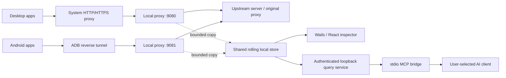

# Architecture

- `internal/capture`: nonblocking prefix copies, bounded queues, storage, HAR and cursors. Forwarded bytes must not change because capture is truncated.
- `internal/platform`: original desktop proxy backup, chaining and recovery.
- `internal/android`: ADB discovery, per-device proxy backup and tunnel cleanup.
- `internal/certificates`: local CA creation and OS trust operations. Upstream TLS verification stays enabled.
- `internal/agent`: authenticated local service, redaction, observations and stdio MCP tools.
- `internal/codex`: local integration installer; preserve unrelated user configuration and create backups.
- `frontend/src`: virtualized request list and bounded on-demand body inspection.
- `third_party/go-mitmproxy`: vendored MIT engine; see its `PATCHES.md` before changing it.

Limits: 1 MiB request/ordinary response, 8 MiB HTML response, 256 MiB body budget, 3,000 flows, 256 × 32 KiB copy blocks, 512 events, 1,024 active captured flows. Body pressure drops the capture suffix; bytes continue downstream. Disk budget eviction removes oldest records. MCP body reads remain capped at 1 MiB even for HTML.

No background daemon survives app exit. Stop restores proxy settings while existing connections may finish; forced process termination can leave proxy settings until recovery. See the [manual](manual.zh-CN.md) for platform details.
